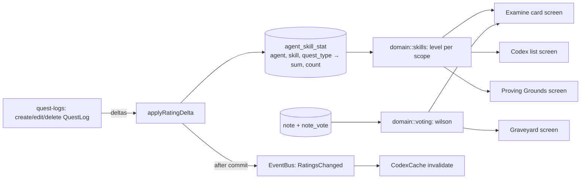

# Design Document: Grand Codex

## Overview

Codex screens read view models from `CodexService`, which loads Agents and their `agent_skill_stat` rows from SQLite and computes levels in memory with the pure scoring modules (`skills`, `voting`, `rate_limit`). These modules are property-tested.

Changes (proposals, Notes, votes, reports, and Keeper actions) go through service commands that run in one transaction. Ratings arrive from the `quest-logs` spec through `applyRatingDelta`, which updates `agent_skill_stat` inside the same transaction as the Quest Log write. After commit, the service publishes `RatingsChanged`, which invalidates the in-memory `CodexCache`.



## Components and interfaces

### Domain

```cpp
// src/domain/skills.hpp
enum class Skill { Coding, Reasoning, Writing, Research, Creativity, ToolUse, Context, Reliability, Speed, Value };
inline constexpr std::array<Skill, 10> SKILLS = { /* display order */ };
struct Overall {};                                       // Quest Log overall rating; shown separately, excluded from totalLevel
using StatKey = std::variant<Skill, Overall>;
enum class QuestType { Coding, Debugging, Writing, Research, Data, Brainstorming, Agentic, Other };
inline constexpr std::array<QuestType, 8> QUEST_TYPES = { /* … */ };
struct Agg { std::int64_t sum = 0; std::int64_t count = 0; bool operator==(const Agg&) const = default; };
inline constexpr int PRIOR_MEAN = 3, PRIOR_WEIGHT = 5, MIN_RATINGS = 3;
Agg mergeAgg(std::span<const Agg> aggs);
Agg aggOf(std::span<const int> ratings);
std::optional<int> skillLevel(const Agg& agg);           // nullopt = unranked
int totalLevel(std::span<const std::optional<int>> levels); // unranked → 1

// src/domain/voting.hpp
double wilsonLowerBound(std::int64_t agree, std::int64_t disagree, double z = 1.96); // 0 when n = 0
enum class VoteValue : int { Disagree = -1, Agree = 1 };
struct VoteOp { std::string userId; std::string noteId; std::optional<VoteValue> value; }; // nullopt = retract
using VoteMap = std::map<std::string, VoteValue>;         // userId → vote, for one Note
enum class VoteError { SelfVote };
Result<VoteMap, VoteError> applyVote(const VoteMap& votes, const VoteOp& op, std::string_view noteAuthorId);
struct Tally { std::int64_t agree = 0, disagree = 0; };
Tally tally(const VoteMap& votes);

// src/domain/slug.hpp
std::string slugify(std::string_view name);              // lowercase ASCII [a-z0-9-], collapsed dashes, trimmed

// src/domain/rate_limit.hpp
bool isAllowed(std::span<const std::chrono::sys_seconds> history, std::chrono::sys_seconds now,
               int limit, std::chrono::seconds window);
```

### Services

- `CodexService::list({ q, kind, vendor, questType, sort, page })` loads approved Agents plus their stats and computes levels in memory. This is fine because the number of Agents is small (< 1,000). Results are memoised in `CodexCache` until the next `RatingsChanged` or `AgentChanged` event.
- `CodexService::card(slug, questType)`.
- `applyRatingDelta(db::Transaction&, agentId, questType, std::span<const Delta>)` upserts stats with an `UPDATE … SET sum = sum + ?, count = count + ?` followed by an `INSERT` only when no row existed (a single `INSERT … ON CONFLICT` can't be used: SQLite checks `CHECK` constraints against the proposed row before it detects the key conflict), and queues `RatingsChanged` for after commit. Quest Logs call it.
- The seeded snapshot writes `seed_sum`/`seed_count` and adjusts `sum`/`count` by the difference between the new and previous baseline, so reseeding is idempotent and never touches ratings players added. Seeded Quest Logs (quest-logs spec) are display-only: their ratings are already inside the snapshot baseline and must not be applied again.
- Commands: `proposeAgent`, `moderateAgent`, `createNote`, `voteOnNote`, `reportContent`, `setNoteHidden`, `resolveReport`, `setKeeper`. Keeper-only commands return `GameError::NotAllowed` for users without the `KEEPER` role.
- Denormalised `agree`/`disagree` counts on `note` are updated in the same transaction as the `note_vote` upsert or delete.
- `ProvingGroundsService::remember(userId, agents, questType)` stores the last comparison in the user's settings JSON. `toPlainText(comparison)` formats the clipboard table.

### Screens

| Screen | Contents |
|---|---|
| Codex list | Bookshelf scene (each Agent is a book spine) + keyboard-navigable `ImGui::BeginTable`, search, filters, sort, Quest_Type selector |
| Examine card | Parchment card, skills grid (pixel skill icons), Boons (green), Banes (red), recent Quest Logs slot, "Write a Quest Log" button, website link with confirmation |
| Propose | Proposal form |
| Proving Grounds | 2–3 Agent pickers, Quest_Type scope, comparison table, "Copy" |
| Graveyard | Tombstone scene (Kiroween only) + list |
| Keeper queue | Pending proposals, Reports, hide/unhide, resolve |

## Data models

Migration `0003_codex.sql`:

```sql
CREATE TABLE agent (
  id             TEXT PRIMARY KEY,
  slug           TEXT NOT NULL UNIQUE,
  name           TEXT NOT NULL,
  vendor         TEXT NOT NULL,
  kind           TEXT NOT NULL CHECK (kind IN ('MODEL','TOOL')),
  examine        TEXT NOT NULL,
  about          TEXT NOT NULL DEFAULT '',
  website        TEXT,                                   -- https: only
  status         TEXT NOT NULL DEFAULT 'PENDING' CHECK (status IN ('PENDING','APPROVED','REJECTED')),
  proposed_by_id TEXT REFERENCES user(id) ON DELETE SET NULL,
  created_at     TEXT NOT NULL,
  updated_at     TEXT NOT NULL
) STRICT;
CREATE INDEX agent_status ON agent(status);

CREATE TABLE agent_skill_stat (
  agent_id   TEXT NOT NULL REFERENCES agent(id) ON DELETE CASCADE,
  skill      TEXT NOT NULL,                              -- StatKey: a Skill or OVERALL
  quest_type TEXT NOT NULL,
  sum        INTEGER NOT NULL DEFAULT 0,
  count      INTEGER NOT NULL DEFAULT 0,
  seed_sum   INTEGER NOT NULL DEFAULT 0,                 -- the seeded community snapshot's share of sum/count,
  seed_count INTEGER NOT NULL DEFAULT 0,                 -- so a reseed swaps only that part (never player ratings)
  PRIMARY KEY (agent_id, skill, quest_type),
  CHECK (count >= 0 AND sum >= count AND sum <= 5 * count),   -- a possible sum of `count` ratings in 1..5
  CHECK (seed_count >= 0 AND seed_sum >= seed_count AND seed_sum <= 5 * seed_count)
) STRICT;

CREATE TABLE note (
  id         TEXT PRIMARY KEY,
  agent_id   TEXT NOT NULL REFERENCES agent(id) ON DELETE CASCADE,
  author_id  TEXT NOT NULL REFERENCES user(id) ON DELETE CASCADE,
  kind       TEXT NOT NULL CHECK (kind IN ('BOON','BANE')),
  skill      TEXT,
  version    TEXT,
  text       TEXT NOT NULL,
  agree      INTEGER NOT NULL DEFAULT 0,
  disagree   INTEGER NOT NULL DEFAULT 0,
  hidden     INTEGER NOT NULL DEFAULT 0 CHECK (hidden IN (0,1)),
  created_at TEXT NOT NULL
) STRICT;
CREATE INDEX note_agent_kind_hidden ON note(agent_id, kind, hidden);

CREATE TABLE note_vote (
  note_id TEXT NOT NULL REFERENCES note(id) ON DELETE CASCADE,
  user_id TEXT NOT NULL REFERENCES user(id) ON DELETE CASCADE,
  value   INTEGER NOT NULL CHECK (value IN (-1, 1)),
  PRIMARY KEY (note_id, user_id)
) STRICT;

CREATE TABLE report (
  id          TEXT PRIMARY KEY,
  target_type TEXT NOT NULL CHECK (target_type IN ('AGENT','NOTE','QUEST_LOG')),
  target_id   TEXT NOT NULL,
  reporter_id TEXT NOT NULL REFERENCES user(id) ON DELETE CASCADE,
  reason      TEXT NOT NULL,
  resolved    INTEGER NOT NULL DEFAULT 0 CHECK (resolved IN (0,1)),
  created_at  TEXT NOT NULL,
  UNIQUE (target_type, target_id, reporter_id)
) STRICT;
```

### Seed Agents (initial set, factual text only)

All seed Agents are FICTIONAL (decision: the demo must not attach invented ratings or opinions to real products). Models: Quillback, Gryphon, Twinwick, Mossling, Mistwren, Deepwell, Grimble, Quartzen. Tools: Spellforge, Pocket Familiar, Cairn, Gryphon Chat, Pathfinder, Sketchling. Vendors are invented and websites use the reserved `.example` domain. When a new seed version drops an Agent, the seeder marks it REJECTED rather than deleting it. Each one has a one-line neutral examine text written in the game voice. Final list and wording are to be reviewed before the demo. Seed files live in `data/seed/agents.json`, `npcs.json`, `quest_logs.json`, and `notes.json`. Seed rows have stable IDs, so upserts are idempotent and never touch rows the player created.

## Correctness properties

**Property 1: Level bounds and ranking threshold.** *For any* multiset of ratings in {1..5}, `skillLevel(aggOf(r))` is `std::nullopt` if `|r| < 3`, and otherwise an integer in [1, 99].
**Validates: Requirements 3.2, 3.3**

**Property 2: Order independence.** *For any* ratings list and any permutation of it, the Skill_Level is identical.
**Validates: Requirement 3.1**

**Property 3: Monotonicity.** *For any* ratings list with at least 3 ratings, appending a `5` never lowers the level, and appending a `1` never raises it.
**Validates: Requirement 3.1**

**Property 4: Scope additivity.** *For any* partition of ratings into Quest_Types, `skillLevel(mergeAgg(perType))` equals `skillLevel(aggOf(allRatings))`.
**Validates: Requirements 3.4, 3.5**

**Property 5: Wilson bounds and ordering.** *For any* `a, d ≥ 0`, `wilsonLowerBound(a, d)` lies in [0, 1]. For a fixed total `n`, it is non-decreasing in `a`.
**Validates: Requirement 5.5**

**Property 6: Vote model.** *For any* sequence of VoteOps, each user has at most one vote per Note. `tally` equals the count of final votes by value. Self-votes are rejected and leave state unchanged.
**Validates: Requirements 5.3, 5.4**

**Property 7: Slug normalization.** *For any* string, `slugify` output matches `^[a-z0-9]+(-[a-z0-9]+)*$` or is empty, and `slugify(slugify(x)) == slugify(x)`.
**Validates: Requirement 4.2**

**Property 8: Rate limit.** *For any* timeline of attempts where an attempt is recorded only when `isAllowed` returns true, no window of length `window` contains more than `limit` recorded attempts.
**Validates: Requirements 4.3, 5.2**

## Error handling

- Duplicate slug: "That Agent is already in the Codex." plus an "Open it" button.
- Rate limited: "You're doing that too often. Rest a while, adventurer."
- Vote on own Note: the button is disabled in the UI, and the service returns `GameError::SelfVote`.
- Keeper command without the role: `GameError::NotAllowed` → "Only a Codex Keeper can do that."
- Invalid website or overlong text: field-level error messages from the domain validators.

## Testing strategy

- P1–P8 live in `tests/property/agent_codex_props.cpp` (label `scoring`, 1000 runs, for P1–P5).
- An integration test checks that `applyRatingDelta` across many random create, edit, and delete operations matches a SQL recompute (the end-to-end check is in `quest-logs` P1).
- An integration test checks that running the seed loader twice gives the same row counts and leaves player-created rows untouched.
- A unit test covers the skills-grid view model rendering "–" for unranked, and the Proving Grounds plain-text formatter.
- Smoke test: open the Codex → search → open a card → switch Quest_Type → compare 2 Agents.
