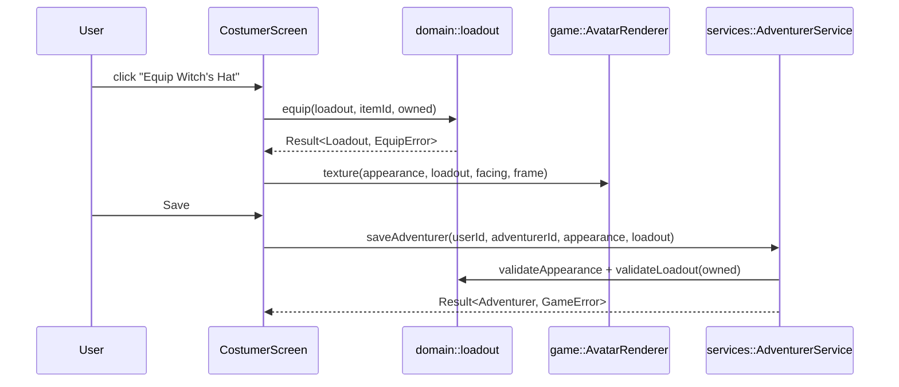

# Design Document: Character Creator and Costumer

## Overview

All rules (name validation, appearance options, equip logic, layer visibility, draw order, and palette mapping) live as pure functions in `src/domain/`. The Costumer screen keeps a draft `{ appearance, loadout }` in view state, renders it through the `AvatarRenderer`, and saves through `AdventurerService`. The service runs the same domain validation again before writing.



## Components and interfaces

### Domain

```cpp
// src/domain/appearance.hpp
enum class BodyType { A, B };
struct Colors { int hair, torso, legs, feet, skin; };              // palette indices
struct Appearance {
  BodyType bodyType;
  int hair; int facialHair;                                         // facialHair 0 = none
  int torso; int arms; int legs;                                    // base clothing styles
  Colors colors;
  bool operator==(const Appearance&) const = default;
};
inline constexpr struct { int hair = 10, facialHair = 8, torso = 6, arms = 4, legs = 6;
  struct { int hair = 12, torso = 16, legs = 16, feet = 6, skin = 8; } colors; } APPEARANCE_LIMITS{};
int cycle(int value, int size, int dir);                            // dir ∈ {1, -1}
Appearance randomAppearance(core::Rng& rng);
Result<Appearance, ValidationError> validateAppearance(const Appearance&);

// src/domain/items.hpp
enum class Slot { Head, Cape, Neck, Weapon, Body, Shield, Legs, Hands, Feet };
enum class Layer { Hair, FacialHair, Arms, Hands, Legs, Feet, Torso };
struct UnlockDefault {}; struct UnlockLevel { int level; }; struct UnlockKiroween { std::optional<int> minLevel; };
using UnlockRule = std::variant<UnlockDefault, UnlockLevel, UnlockKiroween>;
struct Item { std::string_view id, name; Slot slot; std::string_view examine, sprite;
  UnlockRule unlock; bool twoHanded = false; std::span<const Layer> hides = {}; };
std::span<const Item> ITEMS();
const Item* findItem(std::string_view id);

// src/domain/loadout.hpp
using Loadout = std::map<Slot, std::string>;                        // slot → itemId
enum class EquipError { NotUnlocked, UnknownItem };
using OwnedSet = std::set<std::string, std::less<>>;
Result<Loadout, EquipError> equip(const Loadout&, std::string_view itemId, const OwnedSet& owned);
Loadout unequip(const Loadout&, Slot);
Result<Loadout, EquipError> validateLoadout(const Loadout&, const OwnedSet& owned);
std::set<Layer> hiddenLayers(const Loadout&);
enum class Facing { S, E, N, W };
enum class LayerKey { CapeItem, BaseBody, Legs, Feet, Torso, Arms, Hands, LegsItem, FeetItem,
  BodyItem, HandsItem, NeckItem, Hair, FacialHair, HeadItem, ShieldItem, WeaponItem };
std::vector<LayerKey> drawOrder(const Appearance&, const Loadout&, Facing);   // back → front

// src/domain/palette.hpp
struct Rgba { std::uint8_t r, g, b, a; };
using Palette256 = std::array<Rgba, 256>;
Palette256 buildPalette(const Appearance&, const Palette256& base);  // replaces only reserved region indices

// src/domain/adventurer_name.hpp
enum class NameError { Invalid, Blocked };
Result<std::string, NameError> validateName(std::string_view raw, std::span<const std::string_view> blocklist);
std::string nameKey(std::string_view name);                         // lowercase, [ _-] → ' '

// src/domain/appearance_json.hpp, loadout_json.hpp
void to_json(nlohmann::json&, const Appearance&); void from_json(const nlohmann::json&, Appearance&);
void to_json(nlohmann::json&, const Loadout&);    void from_json(const nlohmann::json&, Loadout&);
```

`owned` = all `UnlockDefault` Items plus the user's `item_unlock` ids.

### Item catalog (initial)

| Slot | Default | Level unlocks | Kiroween |
|---|---|---|---|
| HEAD | — | Apprentice Hood (5), Wizard Hat (20) | Witch's Hat, Jack-o'-Lantern Mask, Skull Mask |
| CAPE | — | Traveller's Cape (10), Codex Keeper's Cape (40) | Vampire Cape |
| NECK | — | Token Amulet (15) | — |
| WEAPON | Wooden Stick | Quill Sword (8), Prompt Staff (25, 2h) | Reaper's Scythe (2h, min level 13) |
| BODY | Plain Tunic | Scholar Robe (12) | Ghostly Sheet |
| SHIELD | — | Codex Tome (18) | Candy Pail |
| LEGS | Plain Trousers | Scholar Skirt (12) | — |
| HANDS | — | Leather Gloves (3) | — |
| FEET | Leather Boots | — | Cobweb Boots |

All names and art are original to AgentScape.

### Draw order

`DRAW_ORDER` is a static table indexed by `Facing`. For example, facing S is drawn back to front as `CapeItem, BaseBody, Legs, Feet, Torso, Arms, Hands, LegsItem, FeetItem, BodyItem, HandsItem, NeckItem, Hair, FacialHair, HeadItem, ShieldItem, WeaponItem`. Facing N moves `CapeItem` to the front and `ShieldItem` and `WeaponItem` behind `BaseBody`. `drawOrder` filters the table to the layers that are present and not hidden.

### Renderer (`src/game/avatar_renderer.*`)

- `class AvatarRenderer { SDL_Texture* texture(const Appearance&, const Loadout&, Facing, int idleFrame); Result<SurfacePtr, GameError> exportSurface(const Appearance&, const Loadout&, Facing, int scale = 4); }`
- Sprites are 8-bit indexed PNGs in one atlas (`assets/sprites/avatar.png` + `avatar.json`), loaded with SDL3_image, which keeps the palette.
- To composite a frame, the renderer:
  1. builds the palette with `buildPalette`
  2. applies it to each layer surface (`SDL_SetPaletteColors` on a per-call palette copy; index 0 is the transparent colour key)
  3. blits the layers in `drawOrder` onto a 32×48 RGBA surface
  4. uploads the result as a nearest-scaled texture
- Results are cached in `render::TextureCache` by a hash of `(appearance, loadout, facing, idleFrame)`, so unchanged frames cost nothing.
- Export scales the composited surface by 4× with `SDL_BlitSurfaceScaled(…, SDL_SCALEMODE_NEAREST)`, then passes it to `platform::exportPng`:
  - Desktop: `SDL_ShowSaveFileDialog` + `IMG_SavePNG`.
  - Web: writes to MEMFS, then starts a browser download.

### Services (`src/services/adventurer_service.*`)

`createAdventurer(userId, name)`, `saveAdventurer(userId, id, appearance, loadout)`, `setActiveAdventurer(userId, id)`, `deleteAdventurer(userId, id, confirmName)`, and `claimKiroweenItem(userId, itemId, now)`. Each one validates with the domain functions, checks ownership, runs in one transaction, and returns `Result`.

## Data models

Migration `0002_adventurers.sql`:

```sql
CREATE TABLE adventurer (
  id         TEXT PRIMARY KEY,
  user_id    TEXT NOT NULL REFERENCES user(id) ON DELETE CASCADE,
  name       TEXT NOT NULL,
  name_key   TEXT NOT NULL UNIQUE,
  appearance TEXT NOT NULL,                              -- JSON Appearance
  loadout    TEXT NOT NULL,                              -- JSON Loadout
  is_active  INTEGER NOT NULL DEFAULT 0 CHECK (is_active IN (0,1)),
  created_at TEXT NOT NULL,
  updated_at TEXT NOT NULL
) STRICT;
CREATE INDEX adventurer_user ON adventurer(user_id);
CREATE UNIQUE INDEX adventurer_one_active ON adventurer(user_id) WHERE is_active = 1;

CREATE TABLE item_unlock (
  user_id     TEXT NOT NULL REFERENCES user(id) ON DELETE CASCADE,
  item_id     TEXT NOT NULL,
  source      TEXT NOT NULL CHECK (source IN ('LEVEL','KIROWEEN','GRANT')),
  unlocked_at TEXT NOT NULL,
  PRIMARY KEY (user_id, item_id)
) STRICT;
```

The single-active invariant is enforced twice: by the transaction (unset all, then set one) and by the partial unique index.

## Correctness properties

**Property 1: Appearance and loadout round-trip.** *For any* valid Appearance `a` and Loadout `l`, `json(a).get<Appearance>() == a` (including after `dump()` and `parse()`), and the same holds for `l`.
**Validates: Requirement 7.1**

**Property 2: Slot integrity.** *For any* sequence of `equip` and `unequip` operations from an empty Loadout with any owned set, every entry `slot → itemId` in the result refers to an Item whose `slot` equals that key.
**Validates: Requirements 4.1, 4.2**

**Property 3: Two-handed exclusivity.** *For any* operation sequence, the resulting Loadout never contains both a `twoHanded` WEAPON and a SHIELD item.
**Validates: Requirement 4.3**

**Property 4: Locked items are never equipped.** *For any* operation sequence and owned set `O`, every equipped item id is in `O`. An `equip` call with an id outside `O` returns `NotUnlocked` and leaves the Loadout unchanged.
**Validates: Requirement 4.4**

**Property 5: Hiding does not mutate appearance.** *For any* Appearance and Loadout, `drawOrder` contains no layer in `hiddenLayers(l)`, and the Appearance is unchanged (`drawOrder` takes it by `const&`, and the test compares a copy).
**Validates: Requirement 4.5**

**Property 6: Draw order is a filtered permutation.** *For any* Appearance, Loadout, and Facing, `drawOrder` has no duplicates, is a subsequence of `DRAW_ORDER[facing]`, and contains every present, non-hidden layer.
**Validates: Requirement 3.1**

**Property 7: Cycling wraps.** *For any* `size ≥ 1` and `0 ≤ v < size`, `cycle(v, size, 1)` and `cycle(v, size, -1)` stay in `[0, size)`. Applying `cycle(…, 1)` `size` times returns `v`, and `cycle(cycle(v, size, 1), size, -1) == v`.
**Validates: Requirement 2.3**

**Property 8: Random appearance is valid.** *For any* rng seed, `validateAppearance(randomAppearance(rng))` succeeds.
**Validates: Requirement 2.5**

**Property 9: Name rules.** *For any* string, if `validateName` accepts it, then the result satisfies every rule in 1.1. `nameKey` is idempotent, and two names conflict exactly when their `nameKey`s are equal.
**Validates: Requirements 1.1, 1.2**

## Error handling

| Case | Behaviour |
|---|---|
| Name taken or invalid | `Result` error → red Chatbox message "That name is not available." |
| Equip locked item | Draft unchanged → "You don't have that item yet." |
| Stored JSON fails validation on load (for example, an item was removed from the catalog) | Drop the invalid entries, log the detail, keep the rest, and print "Some of your gear has crumbled to dust." |
| 6th Adventurer | "You can't have more than 5 Adventurers." |
| Export fails or is cancelled | Cancel: nothing happens. Failure: "Your portrait could not be saved." |

## Testing strategy

- P1–P9 live in `tests/property/character_creator_props.cpp`. P2–P4 are model-based (`rc::state`) against a simple reference model.
- Unit tests cover `buildPalette` (only reserved indices change) and the "Describe" text.
- An integration test covers the single-active invariant and the 5-Adventurer limit across create, switch, and delete.
- Visual check: the dev-only avatar gallery screen renders every Item on both body types in four facings for manual review. The smoke test saves a snapshot of it.
