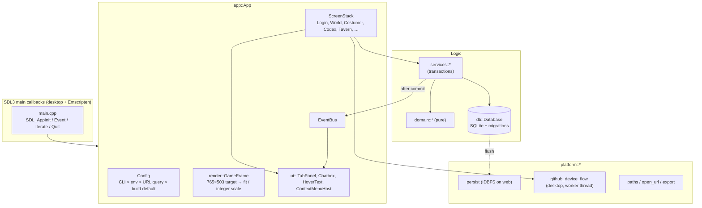

# Design Document: Game Shell

## Overview

`main.cpp` implements the four SDL3 main callbacks and forwards them to `app::App`. `App` owns the window, the renderer, the ImGui context, the database, the services, the `EventBus`, and a `ScreenStack`. Every frame, it:

1. Handles queued SDL events. Pointer coordinates are converted to frame pixels first.
2. Starts an ImGui frame with `DisplaySize = 765×503`.
3. Lays out the Game_Frame: the active Screen draws into the Viewport, then the Tab_Panel, Chatbox, hover text, and Context_Menu are drawn.
4. Renders the scene sprites and ImGui draw data into the 765×503 frame texture.
5. Presents the frame texture scaled to fit ("Fullscreen", the default) or at the integer scale ("Fullscreen" off), with letterboxing.

Screens hold only view state. They call services for data and changes, and they listen to `EventBus` events (for example, `ActivityPosted` or `XpChanged`) to update the Chatbox and effects.

## Architecture



## Components and interfaces

### Domain (pure, `src/domain/`)

```cpp
// src/domain/frame.hpp
namespace as::domain {
inline constexpr int FRAME_W = 765, FRAME_H = 503;
struct FrameLayout { int scale; int offsetX; int offsetY; };
int computeFrameScale(int drawableW, int drawableH);                 // ≥ 1, integer
float computeFitScale(int drawableW, int drawableH);                 // > 0, fractional
FrameLayout layoutFrame(int drawableW, int drawableH, FrameScaling); // scale, size + centring offsets
std::pair<float, float> toFramePoint(const FrameLayout&, float x, float y);
}

// src/domain/kiroween.hpp
enum class KiroweenSetting { Auto, On, Off };
std::optional<KiroweenSetting> parseKiroweenSetting(std::string_view s); // "auto" | "on" | "off"
std::optional<KiroweenSetting> resolveKiroweenSetting(
    std::span<const std::optional<std::string_view>> sourcesByPrecedence);
bool isKiroweenActive(std::optional<KiroweenSetting> setting, std::chrono::sys_seconds now);

// src/domain/context_menu.hpp
struct MenuAction { std::string id; std::string label; std::string target; bool isDefault = false; };
std::vector<MenuAction> buildMenu(std::span<const MenuAction> actions,
                                  std::optional<std::string_view> examineText); // default first, Examine, Cancel last

// src/domain/chat_log.hpp
enum class Channel { Game, Tavern };
struct ChatMessage { std::string id; std::chrono::sys_seconds at; Channel channel; std::string text; };
std::vector<ChatMessage> appendMessages(std::span<const ChatMessage> log,
                                        std::span<const ChatMessage> incoming,
                                        std::size_t max = 100);
```

### App and rendering

| Unit | Notes |
|---|---|
| `app::App` | Owns `SDL_Window`, `SDL_Renderer`, the ImGui context, `db::Database`, services, `EventBus`, and `ScreenStack`. It's the only class that `main.cpp` touches. |
| `app::Config` | Parses `--kiroween`, `--data-dir`, `--reseed`, and `--reset-data`, plus env vars and (web) URL query parameters. |
| `app::EventBus` | Synchronous publish/subscribe with typed events: `ActivityPosted`, `RatingsChanged`, `XpChanged`, `ItemUnlocked`, `GameMessage`. Events are delivered on the main thread, after the publishing service commits. |
| `app::ScreenStack` | `navigate(ScreenId, Params)` and `back()`, both queued and applied at the start of the next frame. The World and the login screen are hubs: navigating to one clears the history, which is how "To town" works. Each Screen implements `onEnter`, `update(FrameCtx&)`, `draw(FrameCtx&)`, and optionally `tabOverride()`, `onContextAction()` and `onEscape(FrameCtx&)`. On `Escape` / gamepad B, App calls `onEscape` first; a screen returns true to stay (it closed a form, confirmation or step, or it is warning about unsaved work), and otherwise App calls `back()` (Requirements 7.6–7.8). |
| `render::GameFrame` | Owns the frame `SDL_TEXTUREACCESS_TARGET` texture (nearest), sized 765×503 times the render resolution `r = frameRenderRes(layout, mode)`: the whole part of the scale (Fit) or the largest factor of the integer scale (Integer), at most 4. Drawing into it uses `SDL_SetRenderScale(r, r)`, so game code still works in frame pixels, and the fonts are rasterised at `r` times their size and drawn at `1/r` (Silkscreen's glyphs hardened to solid pixels), so text is sharp at large scales. Uses `layoutFrame(SDL_GetWindowSizeInPixels, mode)` each frame. The final blit is either an exact whole-number enlargement (nearest) or a stretch of less than 2× with linear filtering ("sharp bilinear"). |
| `render::TextureCache` | Loads PNGs through SDL3_image with nearest scaling. Also holds an LRU of composited textures (avatars, thumbnails). |
| `render::NineSlice` | Draws a 9-slice from the UI atlas through `ImDrawList::AddImage`. |

### UI (`src/ui/`)

| Widget | Notes |
|---|---|
| `ui::applyTheme` | Maps the palette constants to `ImGuiStyle`. Sets all rounding to 0, turns off anti-aliasing, and sets a yellow 2 px nav cursor. |
| `ui::StonePanel` | RAII scope (`StonePanel panel{"Title", Variant::Stone}`) that draws a 9-slice background and an orange shadowed title. |
| `ui::PixelButton` | Bevelled button with a pressed state. Returns `true` on activation. Plays the click sound if enabled. |
| `ui::ShadowText` / `ui::RichText` | Shadowed text. `RichText` renders `<col=…>` markup parsed by `ui::parseMarkup`. |
| `ui::HoverText` | Reads the hover target from `UiState`. |
| `ui::ContextMenuHost` | ImGui popup positioned at the pointer or focus rectangle. Its navigation state machine (`ContextMenuModel`) is plain C++ so it can be unit-tested. |
| `ui::Chatbox` | `All`, `Game`, and `Tavern` tabs over `appendMessages`. Subscribes to `ActivityPosted` and `GameMessage`. |
| `ui::TabPanel` | Icon tabs: Equipment, Skills, Quest Log, Settings. |

### Game (`src/game/world_map.*`)

- `class WorldMap { void setKiroween(bool); void setAdventurer(const AvatarKey&); HotspotHit hitTest(float fx, float fy) const; void update(double dt, bool reduceMotion); void draw(SDL_Renderer*); }`
- The map is a pre-composed background PNG plus animated overlays (jack-o'-lanterns, fog, bats).
- Hotspots are data in `src/game/hotspots.cpp` (`{ id, name, polygon, screen, actions, examine, kiroweenOnly }`). The same data drives the keyboard and gamepad list.
- Hit testing uses point-in-polygon in frame coordinates.

### Platform

- `platform::paths`: `dataDir()` returns `SDL_GetPrefPath` or `--data-dir` on desktop, and `/persist` on the web. `assetsDir()` returns `SDL_GetBasePath()/assets` on desktop, and `/assets` (preloaded) on the web.
- `platform::persist`:
  - Web: mounts IDBFS at `/persist` and runs `FS.syncfs(true)` before the database opens; `App` shows "Loading…" until it finishes. `requestFlush()` schedules a debounced `FS.syncfs(false)` (250 ms) and also flushes on `pagehide`.
  - Desktop: no-op.
- `platform::github_device_flow`: a state machine (`Idle → RequestingCode → AwaitingUser{userCode, verificationUri, interval, expiresAt} → Polling → Succeeded{githubId, login, name} | Failed{reason}`).
  - HTTP runs on a worker thread through libcurl, and results arrive as SDL user events.
  - The access token lives only in a local variable, long enough to call `GET https://api.github.com/user`.
  - Compiled out on Emscripten.
- `platform::openUrl` wraps `SDL_OpenURL`.

### Services

- `services::ProfileService`: `createGuest(rng, now)`, `signInGitHub(profile, now)`, `listLocalUsers()`, `rememberUser(id)`, `updateSettings(userId, Settings)`, `cleanupGuests(now)`.
- `services::ActivityService`: `post(tx, kind, text, now)` and `latest(limit)`. Publishes `ActivityPosted` after commit.

## Data models

Migration `0001_init.sql`:

```sql
CREATE TABLE user (
  id           TEXT PRIMARY KEY,                       -- ULID
  name         TEXT NOT NULL,
  kind         TEXT NOT NULL DEFAULT 'PLAYER' CHECK (kind IN ('PLAYER','GUEST','NPC')),
  role         TEXT NOT NULL DEFAULT 'USER'   CHECK (role IN ('USER','KEEPER')),
  github_id    INTEGER UNIQUE,                         -- NULL unless linked through GitHub_Login
  github_login TEXT,
  settings     TEXT NOT NULL DEFAULT '{}',             -- JSON { plainFont, reduceMotion, sound }
  created_at   TEXT NOT NULL,                          -- ISO-8601 UTC
  last_seen_at TEXT NOT NULL
) STRICT;

CREATE TABLE app_state (                               -- single-row key/value, e.g. remembered_user_id
  key   TEXT PRIMARY KEY,
  value TEXT NOT NULL
) STRICT;

CREATE TABLE activity_event (
  id         INTEGER PRIMARY KEY AUTOINCREMENT,
  kind       TEXT NOT NULL CHECK (kind IN ('QUEST_LOG_CREATED','LEVEL_UP','AGENT_APPROVED','NOTE_CREATED')),
  text       TEXT NOT NULL,                            -- pre-rendered game-voice text
  created_at TEXT NOT NULL
) STRICT;
CREATE INDEX activity_event_created_at ON activity_event(created_at);
```

## Correctness properties

**Property 1: Frame scale is the largest integer that fits.** *For any* drawable width and height ≥ 1, `s = computeFrameScale(w, h)` satisfies `s ≥ 1`. If `w ≥ 765` and `h ≥ 503`, then `765·s ≤ w`, `503·s ≤ h`, and `765·(s+1) > w || 503·(s+1) > h`.

**Property 1b: Fit scaling fills the window and maps the pointer.** *For any* drawable size, the Fit layout lies inside the window, touches one pair of opposite edges (to within a pixel), is at least the integer scale, and `toFramePoint` maps the presented corners to `(0,0)` and `(765,503)` in both modes.
**Validates: Requirement 1.1**

**Property 2: Kiroween resolution.** *For any* `now`, setting `On` returns true and `Off` returns false. For `Auto` or `std::nullopt`, the result is true exactly when the UTC (month, day) falls between (10, 1) and (11, 15), inclusive. *For any* list of sources, `resolveKiroweenSetting` returns the first one that parses.
**Validates: Requirements 6.1, 6.2, 6.3**

**Property 3: Context menu shape.** *For any* non-empty action list with exactly one default, `buildMenu` returns a list where the first item is the default, the last item is `Cancel`, `Examine` appears exactly once if and only if examine text is given, and every input action appears exactly once.
**Validates: Requirements 4.1, 4.2**

**Property 4: Chat log append.** *For any* existing log and incoming batch, `appendMessages` returns at most `max` messages. It has no duplicate ids, keeps chronological order, keeps the newest messages, and is idempotent (appending the same batch twice equals appending it once).
**Validates: Requirements 5.4, 5.5**

## Error handling

| Case | Behaviour |
|---|---|
| Database open or migration fails | "Your save could not be loaded." panel with "Start fresh" (backs up the old file) and "Quit". Details go to `SDL_Log`. |
| Write transaction fails | The transaction rolls back, and the service returns `GameError::StorageFailed` → "Something went wrong. Nothing was saved." |
| Accelerated renderer unavailable | `SDL_CreateRenderer` falls back to the `software` renderer on desktop. On the web, `shell.html` shows "Your browser needs WebGL to play AgentScape." |
| IDBFS load fails (web) | Warn "Your progress can't be saved in this browser (private mode?)." and continue with an in-memory database. |
| GitHub device flow: denied, expired, or network error | Red message on the login screen: "GitHub sign-in was cancelled.", "That code expired. Try again.", or "You can't reach GitHub right now." Guest login is always still available. |

## Testing strategy

- Property tests P1–P4 in `tests/property/game_shell_props.cpp`.
- Unit tests:
  - `ContextMenuModel` keyboard and gamepad navigation.
  - Chatbox channel filtering.
  - `parseMarkup`.
  - Device-flow response parsing and `slow_down` back-off.
  - `Config` precedence.
- Integration tests:
  - The migration runner on `:memory:`.
  - `ProfileService.createGuest` and `cleanupGuests`.
- Smoke test: guest login → World → open the Tavern through the context menu.
