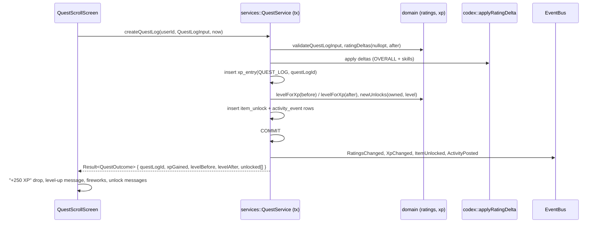

# Design Document: Quest Logs, Questing XP and Hiscores

## Overview

Every write that affects ratings or XP runs through one service function in a single SQLite transaction (`BEGIN IMMEDIATE`):

1. Validate the input with the domain validators.
2. Insert, update, or delete the Quest Log.
3. Compute rating deltas with the pure function `ratingDeltas(before, after)`, then call `applyRatingDelta` (from agent-codex).
4. Insert or delete XP entries.
5. Recompute the level and grant new unlocks with `newUnlocks`.
6. Write ActivityEvents.

After commit, the service publishes `RatingsChanged`, `XpChanged`, `ItemUnlocked`, and `ActivityPosted` on the `EventBus`, and asks `platform::persist` to flush (web). The command returns a `QuestOutcome` that the screen turns into chatbox messages, XP drops, and fireworks.



## Components and interfaces

### Domain

```cpp
// src/domain/ratings.hpp
using Stars = int;                                              // 1..5, enforced by validators
struct RatingSet { QuestType questType; Stars overall; std::map<Skill, Stars> skills; bool excluded = false; };
struct Delta { StatKey skill; QuestType questType; std::int64_t sumDelta; std::int64_t countDelta; };
std::vector<Delta> ratingDeltas(const std::optional<RatingSet>& before,
                                const std::optional<RatingSet>& after);   // excluded ≡ nullopt
std::vector<Delta> sumDeltas(std::span<const std::vector<Delta>> lists);  // merges by (skill, questType), drops zeros

struct QuestLogInput { std::string agentId; std::string version; QuestType questType; Stars overall;
  std::map<Skill, Stars> skills; std::string title; std::string body; bool recommend;
  std::vector<std::string> pros; std::vector<std::string> cons; };
Result<QuestLogInput, ValidationErrors> validateQuestLogInput(const QuestLogInput&);
inline constexpr std::array PRO_TAGS = { /* see Quick tags */ };
inline constexpr std::array CON_TAGS = { /* see Quick tags */ };

// src/domain/xp.hpp
inline constexpr int MAX_LEVEL = 99;
extern const std::array<std::int64_t, MAX_LEVEL + 1> XP_TABLE;  // index 1..99; [0] unused
int levelForXp(std::int64_t xp);                                // 1..99
enum class XpReason { QuestLog, Note, HelpfulReceived, AgentApproved, Seed };
inline constexpr struct { int questLog = 250, note = 50, helpfulReceived = 25, agentApproved = 500; } XP_REWARDS{};
inline constexpr int HELPFUL_DAILY_CAP = 250;
int helpfulXpAllowed(int alreadyTodayXp);                       // 0 or 25, never exceeds the cap
std::vector<std::string> newUnlocks(const OwnedSet& owned, int level);   // level-rule items ≤ level not owned

// src/domain/ranking.hpp
template <class T, class Score, class Name>
std::vector<std::pair<T, int>> competitionRank(std::vector<T> rows, Score score, Name name);
```

### Quick tags (fixed lists)

- **Pros:** Accurate, Fast, Clear explanations, Followed instructions, Clean code, Good with large context, Great value, Creative.
- **Cons:** Hallucinated, Slow, Too verbose, Ignored instructions, Outdated knowledge, Lost context, Expensive, Over-refused.

### Services

- `QuestService`: `createQuestLog`, `updateQuestLog`, `deleteQuestLog`, `toggleHelpful`, `setQuestLogModeration({ hidden, excluded })` (Keeper only). Reports use the shared `reportContent`.
- `XpService::award(tx, userId, reason, refId, amount)` runs `INSERT INTO xp_entry … ON CONFLICT (user_id, reason, ref_id) DO NOTHING` and checks `sqlite3_changes()` to know whether XP was actually awarded. After awarding, it recomputes the level and grants unlocks. `XpService::revoke(tx, userId, refId)` deletes entries that reference a Quest Log.
- Note and proposal XP: the agent-codex commands `createNote` and `moderateAgent` call `XpService::award`. That wiring is a task in this spec.
- `HiscoresService::agents({ board, questType, page })` and `HiscoresService::adventurers({ page })` are computed in memory from aggregates and memoised until the next `RatingsChanged` or `XpChanged` event.

### Screens and effects

| Screen / unit | Notes |
|---|---|
| Tavern board | Notice-board background, pinned parchment `QuestLogCard`s, filters, pagination |
| Quest scroll | 3-step form with gem rating inputs (radio groups, keyboard and gamepad friendly). Opened with an Agent pre-selected from the Codex card. |
| Quest detail | Full Quest Log, Helpful button, Report, Edit/Delete for the author |
| Hiscores | Stone obelisk panel with tabs (Agents / Adventurers), board selector (Overall, Total, each Skill with icon), Quest_Type scope, search |
| `game::XpDrop`, `game::Fireworks` | Effects triggered by `QuestOutcome`. Fireworks use a seeded particle system and show a static burst when "Reduce motion" is on. |
| `AvatarThumb` | Draws an Adventurer_Snapshot through the shared `AvatarRenderer` and keeps it in the `TextureCache` LRU, keyed by snapshot hash |

## Data models

Migration `0004_quests.sql`:

```sql
CREATE TABLE quest_log (
  id            TEXT PRIMARY KEY,
  author_id     TEXT NOT NULL REFERENCES user(id) ON DELETE CASCADE,
  agent_id      TEXT NOT NULL REFERENCES agent(id) ON DELETE CASCADE,
  agent_version TEXT NOT NULL DEFAULT '',
  quest_type    TEXT NOT NULL,
  overall       INTEGER NOT NULL CHECK (overall BETWEEN 1 AND 5),
  ratings       TEXT NOT NULL DEFAULT '{}',             -- JSON map<Skill, 1..5>
  title         TEXT NOT NULL,
  body          TEXT NOT NULL,
  recommend     INTEGER NOT NULL CHECK (recommend IN (0,1)),
  tags          TEXT NOT NULL DEFAULT '[]',             -- JSON string[]
  snapshot      TEXT NOT NULL,                          -- JSON Adventurer_Snapshot
  helpful_count INTEGER NOT NULL DEFAULT 0,
  hidden        INTEGER NOT NULL DEFAULT 0 CHECK (hidden IN (0,1)),
  excluded      INTEGER NOT NULL DEFAULT 0 CHECK (excluded IN (0,1)),
  created_at    TEXT NOT NULL,
  updated_at    TEXT NOT NULL,
  UNIQUE (author_id, agent_id, agent_version)
) STRICT;
CREATE INDEX quest_log_agent_hidden ON quest_log(agent_id, hidden);
CREATE INDEX quest_log_created_at ON quest_log(created_at);

CREATE TABLE helpful_vote (
  quest_log_id TEXT NOT NULL REFERENCES quest_log(id) ON DELETE CASCADE,
  user_id      TEXT NOT NULL REFERENCES user(id) ON DELETE CASCADE,
  created_at   TEXT NOT NULL,
  PRIMARY KEY (quest_log_id, user_id)
) STRICT;

CREATE TABLE xp_entry (
  id         TEXT PRIMARY KEY,
  user_id    TEXT NOT NULL REFERENCES user(id) ON DELETE CASCADE,
  reason     TEXT NOT NULL CHECK (reason IN ('QUEST_LOG','NOTE','HELPFUL_RECEIVED','AGENT_APPROVED','SEED')),
  ref_id     TEXT NOT NULL,   -- questLogId, noteId, '<questLogId>:<voterId>', agentId, 'seed'
  amount     INTEGER NOT NULL,
  created_at TEXT NOT NULL,
  UNIQUE (user_id, reason, ref_id)
) STRICT;
CREATE INDEX xp_entry_user ON xp_entry(user_id);

ALTER TABLE user ADD COLUMN total_xp INTEGER NOT NULL DEFAULT 0;
```

`user.total_xp` is a denormalised value that is updated in the same transaction. The ledger remains the source of truth, and `--repair-xp` recomputes `total_xp` from it.

## Correctness properties

**Property 1: Incremental aggregates equal recompute.** *For any* sequence of create, edit, delete, and exclude operations on Quest Logs, folding `ratingDeltas` into an empty aggregate map equals `aggOf` over the final set of non-deleted, non-excluded Quest Logs, for every (Skill or `Overall`, Quest_Type).
**Validates: Requirements 2.1, 2.2, 2.3**

**Property 2: Delta algebra.** *For any* RatingSets `a`, `b`, `c` (or `nullopt`), `sumDeltas({ratingDeltas(a, b), ratingDeltas(b, c)})` equals `ratingDeltas(a, c)`, and `ratingDeltas(a, a)` is empty.
**Validates: Requirement 2.1**

**Property 3: XP table and level.** `XP_TABLE` is strictly increasing, with `XP_TABLE[1] = 0`. *For any* `xp ≥ 0`, `L = levelForXp(xp)` lies in [1, 99], `XP_TABLE[L] ≤ xp`, and either `L = 99` or `xp < XP_TABLE[L+1]`.
**Validates: Requirement 5.4**

**Property 4: Level monotonicity.** *For any* `x ≤ y`, `levelForXp(x) ≤ levelForXp(y)`.
**Validates: Requirement 5.4**

**Property 5: Unlocks are monotone and idempotent.** *For any* owned set and level `L`, `newUnlocks(owned ∪ newUnlocks(owned, L), L)` is empty. *For any* `L1 ≤ L2`, the items unlocked by `L1` are a subset of those unlocked by `L2`.
**Validates: Requirements 6.1, 6.3**

**Property 6: Helpful XP daily cap.** *For any* sequence of helpful votes received by an author in one UTC day, the sum of awarded helpful XP is at most `HELPFUL_DAILY_CAP`, and it equals `min(25 · votes, 250)`.
**Validates: Requirement 5.1**

**Property 7: Competition ranking.** *For any* rows, ranks are non-decreasing in output order, equal scores share a rank, and each rank equals 1 plus the number of rows with a strictly higher score.
**Validates: Requirement 7.3**

**Property 8: Input validation.** *For any* generated `QuestLogInput`, `validateQuestLogInput` accepts it if and only if all field constraints in Requirement 1.1 hold. Accepted inputs round-trip through the JSON codec unchanged.
**Validates: Requirement 1.1**

## Error handling

| Case | Message |
|---|---|
| Duplicate (user, Agent, version) | The form loads the existing log for editing: "You've already logged this quest. Update it instead?" |
| Rate limited | "You're doing that too often. Rest a while, adventurer." |
| Helpful on own log | Button hidden. The service returns `GameError::SelfVote`. |
| Transaction failure | The transaction rolls back, so nothing is partially written. "Something went wrong. Your quest scroll was not saved." |

## Testing strategy

- P1–P8 live in `tests/property/quest_logs_props.cpp`. P1 is model-based (`rc::state`), and the numeric properties run with the `scoring` label (1000 runs).
- Integration test: run the real `QuestService` against `:memory:` for 50 random operations, then assert that `agent_skill_stat` equals a SQL recompute and `user.total_xp` equals the ledger sum.
- Smoke test (demo path): guest → Codex card → "Write a Quest Log" → submit → see "+250 XP" and the level-up message → Hiscores shows the guest.
