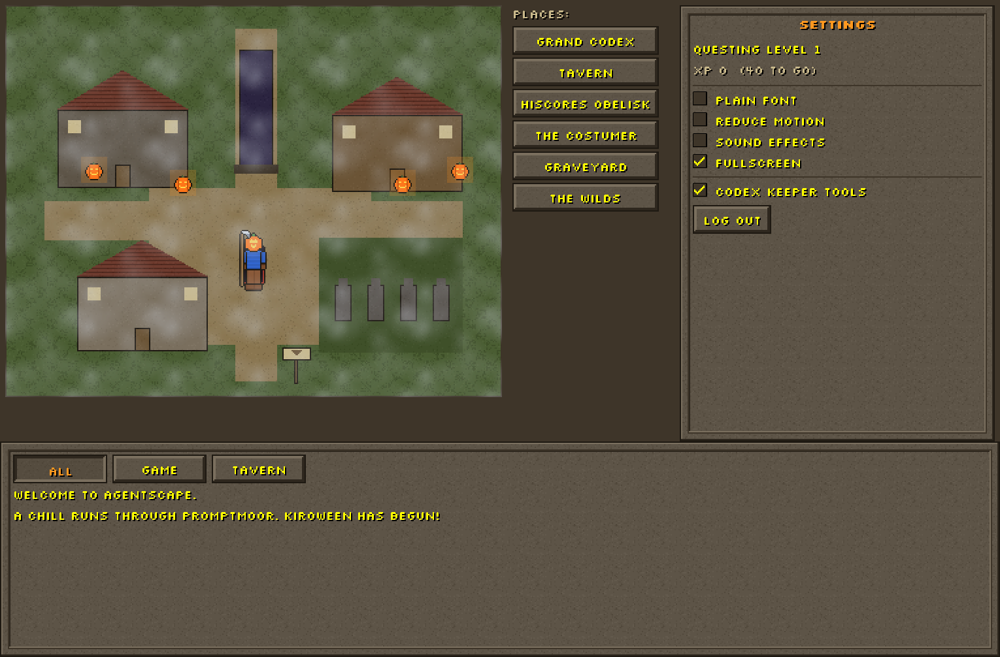
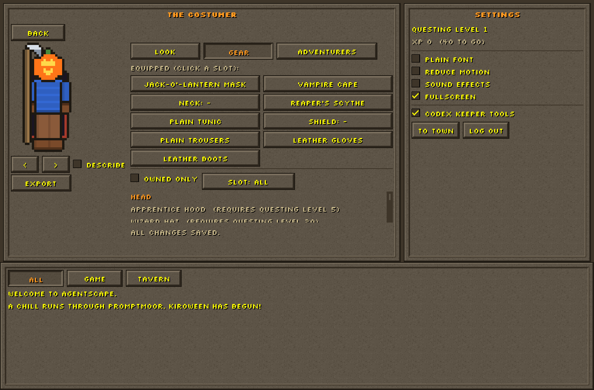
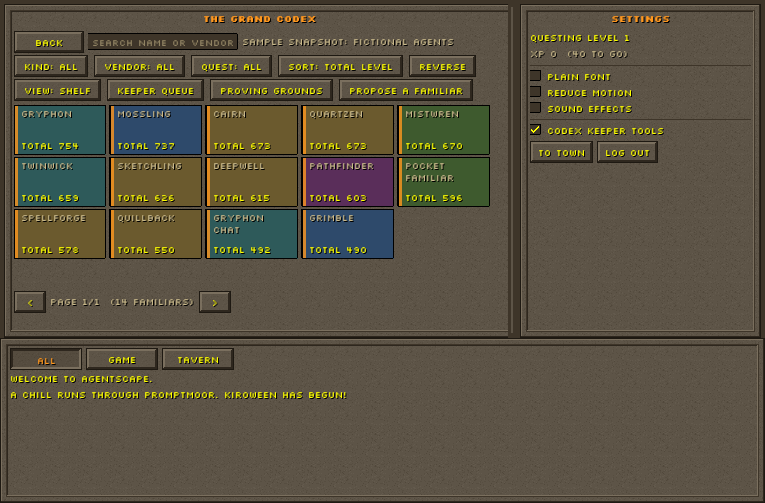
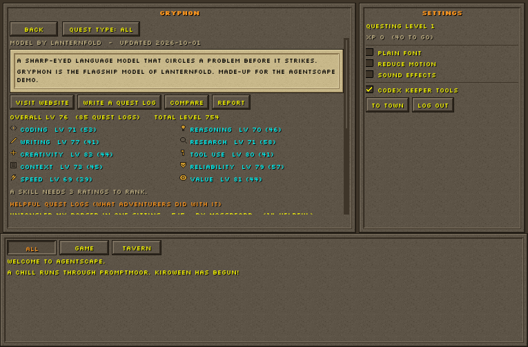
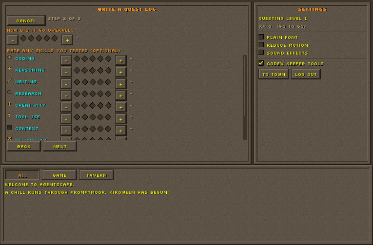
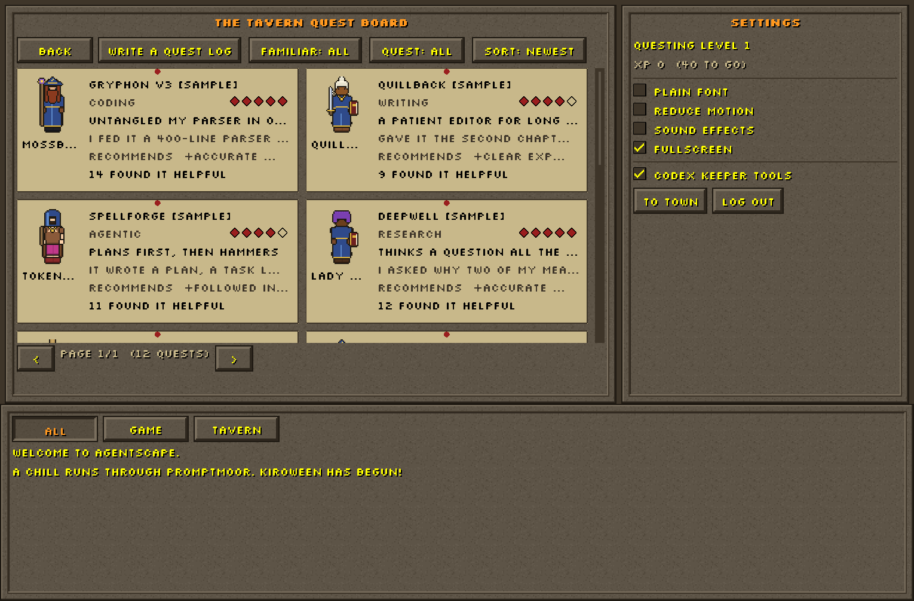
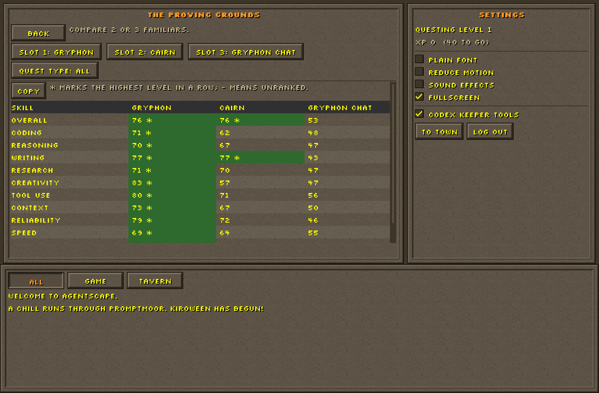
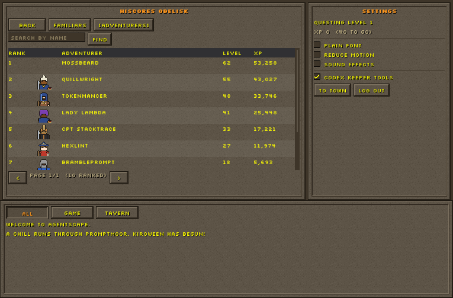
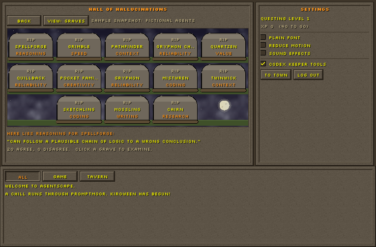
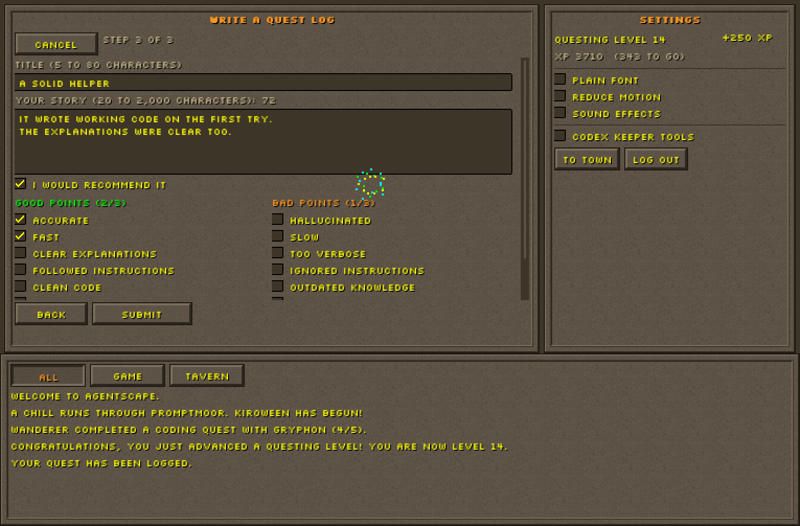

# AgentScape

> *Welcome to AgentScape.* Rate the AI models and tools you use, and build a codex of their strengths and weaknesses, inside a lovingly resurrected early-2000s fantasy MMO client. It runs natively on your desktop and in your browser.

Built for **Kiroween 2026**, **Resurrection** category. Licensed under the [MIT License](LICENSE).



**▶ Play in your browser:** <https://marquisxgrove.github.io/AgentScape/> · **Download:** [latest release](https://github.com/marquisxgrove/AgentScape/releases/latest) (Windows, macOS, Linux)

> The web build is published by `.github/workflows/pages.yml` and the release archives by `.github/workflows/release.yml` (push a `v*` tag). Until those have run once, the links above are empty; see [Publishing](#publishing).

## What you can do

- **Create and dress up Adventurers.** A classic arrow-button character designer (6 style axes, 5 colour palettes, 4-way rotation), a 9-slot paper-doll, and unlockable cosmetics, including **Kiroween gear** like the Witch's Hat, Jack-o'-Lantern Mask, Vampire Cape and Reaper's Scythe. Export a 4× transparent PNG portrait.
- **Explore Promptmoor.** A clickable pixel town with hover text, right-click menus, *Examine*, and a living chatbox. Every place is also in a keyboard-friendly list beside the map.
- **Consult the Grand Codex.** Every AI familiar (model or tool) has an *examine card* with an Overall level and **10 Skill levels (1–99)** built from ratings and filterable by Quest Type, plus community-voted **Boons** (strengths) and **Banes** (weaknesses). Browse it as a bookshelf or a table; search, filter, sort and page through it. Propose a missing familiar.
- **Write Quest Logs at the Tavern.** A 3-step quest scroll: which familiar, gem ratings for the overall result and any Skills, then the story and quick tags. Earn **Questing XP**, level up (fireworks included), and unlock cosmetics. Mark other adventurers' logs Helpful.
- **Compare familiars** side by side in the **Proving Grounds**, and climb the **Hiscores** (familiars by any Skill, adventurers by XP).
- **Earn XP while you code.** Head to **The Wilds**, say who you're coding with (a familiar, or solo) and start a session. You earn 1 XP a minute, even with the game closed (up to 4 hours a session, 8 hours a day), while your Adventurer squashes bug monsters with the familiar, or chops, mines and fishes on its own.
- **Visit the Hall of Hallucinations** during Kiroween: a graveyard of the community's most-agreed AI failures.
- **Moderate your local Codex** with the Codex Keeper tools (Settings): approve proposals, hide or unhide Notes and Quest Logs, exclude ratings, and resolve reports.

Everything is stored locally in SQLite (in IndexedDB on the web). No server, no AI API calls, and it works offline.

**About the data.** The Codex ships with a *sample snapshot* so it is alive on first run: 14 familiars, their vendors and websites, ratings, Boons, Banes, 8 townsfolk and their Quest Logs. **All of it is fictional.** The familiars and vendors are invented (websites use the reserved `.example` domain) and describe no real product. Your own Quest Logs and Notes are real and update the levels instantly.

| | | |
|---|---|---|
|  |  |  |
| The Costumer: Kiroween gear on the paper-doll | The Grand Codex bookshelf | An examine card: levels by Skill, top Quest Logs |
|  |  |  |
| The quest scroll's gem ratings | The Tavern quest board | The Proving Grounds |
|  |  |  |
| Hiscores | The Hall of Hallucinations | A Guest's first Quest Log: +250 XP and a level-up |

## Playing

- **Start:** click **Play as Guest** to jump straight in. A Guest starts at Questing level 13, so the early cosmetics and the Reaper's Scythe are already claimable, and the first Quest Log is a level-up. Your Guest stays signed in on this device until you **Log out**. A Guest can't be signed back into, so Log out asks first; logged-out Guests idle for more than 24 hours are cleaned up on the next launch.
- **Keep a profile:** click **Create a profile** and pick a name (up to 12 letters or numbers). A profile is permanent, starts at Questing level 1, and is listed under *Or continue as* whenever you're logged out. There's no password: profiles live only on this device. On a desktop build with a GitHub client ID, **Sign in with GitHub** makes the same kind of profile from your GitHub account (see [Building](#building)).
- **Coding sessions:** in **The Wilds** (the road south, or *Places*), pick a familiar or *Solo* and press **Start session** before you code; press **Stop session** when you're done. XP is paid as you go and for time spent away ("While you were away…"). After a session with a familiar, *Write a Quest Log* rates it while it's fresh.
- **Getting around:** every screen has **Back** (or **Cancel**), and **To town** in the right panel returns to the town map from anywhere.
- **Mouse:** left-click to use, right-click for the context menu, hover for the top-left hover text.
- **Keyboard and gamepad:** arrow keys / D-pad and Tab move the yellow focus cursor, Enter / A activates. Escape / B closes whatever is open (a form, a confirmation, a step of the quest scroll), and otherwise goes back a screen. If that would throw away a half-written Quest Log, unsaved Costumer changes or a started proposal, it asks for a second press. The `Menu` key, Shift+F10 or gamepad Y opens the context menu on the focused item.
- **Settings** (right panel): *Plain font* (Atkinson Hyperlegible instead of the pixel font), *Reduce motion* (still fog, idle and fireworks; on the web it follows the browser setting for new Guests), *Codex Keeper tools*.
- **Kiroween** runs from 1 October to 15 November (UTC). Force it with `--kiroween=on`, `KIROWEEN_MODE=on`, `?kiroween=on` on the web, or the `AS_KIROWEEN_DEFAULT=on` build option. The published web and release builds have it on.

## Tech stack

C++20 · SDL3 · SDL3_image · Dear ImGui · SQLite · nlohmann/json · tl::expected · libcurl (optional desktop GitHub sign-in) · CMake + Ninja · Emscripten (WebAssembly) · Catch2 · RapidCheck. Licenses: [THIRD_PARTY_NOTICES.md](THIRD_PARTY_NOTICES.md).

## Building

### Prerequisites

- **CMake 3.25+** and **Ninja**
- A C++20 compiler: **Visual Studio 2022 17.8+** (Windows), **Clang 17+** (macOS/Linux), or **GCC 13+** (Linux)
- **Git** (dependencies are fetched at configure time)
- Linux only: the SDL3 build dependencies for your distro (X11/Wayland, ALSA/PulseAudio/PipeWire dev packages). On Ubuntu 24.04: `sudo apt-get install ninja-build libx11-dev libxext-dev libxrandr-dev libxcursor-dev libxi-dev libxss-dev libwayland-dev libxkbcommon-dev libasound2-dev libpulse-dev libgl1-mesa-dev libegl1-mesa-dev libdrm-dev libgbm-dev`
- For the web build: **Emscripten 4.x** via [emsdk](https://emscripten.org/docs/getting_started/downloads.html), with `EMSDK` set

### Desktop

```bash
git clone https://github.com/marquisxgrove/AgentScape.git
cd AgentScape
cmake --preset dev
cmake --build --preset dev
./build/dev/agentscape          # Windows: .\build\dev\agentscape.exe
```

The database and seed data are created automatically on first launch, in your user data folder (`SDL_GetPrefPath("AgentScape", "AgentScape")`: `%APPDATA%\AgentScape\AgentScape` on Windows, `~/Library/Application Support/AgentScape/AgentScape` on macOS, `~/.local/share/AgentScape/AgentScape` on Linux).

To enable **Sign in with GitHub** on desktop, create a GitHub OAuth App (*Settings → Developer settings → OAuth Apps*; any homepage and callback URL will do) with **Enable Device Flow** turned on, then configure with `cmake --preset dev -DAS_GITHUB_CLIENT_ID=<client id>`. No client secret is needed. This also builds libcurl, using the system's TLS (Schannel on Windows, Secure Transport on macOS, OpenSSL on Linux, so install `libssl-dev` there). For the release builds, put the client ID in the repository variable `AS_GITHUB_CLIENT_ID` (*Settings → Secrets and variables → Actions → Variables*). Without it, the app offers Play as Guest and local profiles. If sign-in fails, the log line starting `GitHub sign-in:` says which step failed and why.

### Web

```bash
cmake --preset web
cmake --build --preset web
emrun build/web/agentscape.html   # add ?kiroween=on to the URL to force Kiroween mode
```

### Commands

| Command | Description |
|---|---|
| `cmake --preset dev` · `cmake --build --preset dev` | Configure and build (Debug, with the dev QA screens) |
| `ctest --preset dev` | All unit, integration, property and smoke tests (393 at submission) |
| `ctest --preset dev -L property` / `-L smoke` | Property-based tests only / the headless smoke tests only |
| `cmake --preset tests-only` · `cmake --build --preset tests-only` · `ctest --preset tests-only` | Domain, service and database tests without SDL or a window |
| `cmake --build --preset dev --target format` / `tidy` | `clang-format` / `clang-tidy` |
| `cmake --preset asan` · `cmake --build --preset asan` · `ctest --preset asan` | AddressSanitizer + UBSan build and tests |
| `cmake --preset web` · `cmake --build --preset web` | WebAssembly build |
| `cmake --preset release -DAS_BUILD_TESTS=OFF` · `cmake --build --preset release` | Release build (the binary and an `assets/` folder in `build/release/`) |
| `agentscape --reseed` | Re-apply the sample snapshot (never touches your own logs, notes, votes or XP) |
| `agentscape --reset-data` | Back up the save as `agentscape.db.bak-<timestamp>` and start fresh |
| `agentscape --data-dir <path>` | Use another data folder |
| `agentscape --repair-xp` | Recompute every user's XP total from the XP ledger |

### Unsigned builds

Release binaries aren't code-signed. On macOS, right-click the app and choose **Open** the first time (or run `xattr -d com.apple.quarantine agentscape`). On Windows, choose **More info → Run anyway** in SmartScreen. Or just use the web build.

## Publishing

1. **Web:** in the repository's *Settings → Pages*, set *Source* to **GitHub Actions** once. (Left on *Deploy from a branch*, the site shows this README instead of the game, and the deploy job fails with a 404.) After that, every push to `main` that passes CI builds the web target with Kiroween on and deploys it (`.github/workflows/pages.yml`). To publish straight away, run *Deploy web build* from the Actions tab.
2. **Desktop:** push a version tag, for example `git tag v1.0.0 && git push origin v1.0.0`. `.github/workflows/release.yml` builds Windows, macOS and Linux archives and a web zip, all with Kiroween on, and attaches them to a GitHub Release.

## Testing

- **Property-based tests** (RapidCheck) for every pure domain rule: 33 numbered correctness properties across the five specs, from "incremental rating aggregates equal a full recompute" to "two-handed weapons and shields never coexist". Scoring maths runs 1,000 cases per property.
- **Unit and integration tests** (Catch2) for services and repositories against a fresh in-memory SQLite with every migration applied.
- **Headless smoke tests** that drive the real app with SDL's dummy video driver and save a snapshot of every screen (`src/app/smoke_runs.cpp`). `smoke_demo_path` plays the whole demo path (Guest → Costumer with Kiroween gear → Codex card → Quest Log → +250 XP and level-up → Hiscores), then restarts the app on the same database and checks everything survived.
- **CI** (`.github/workflows/ci.yml`) builds and tests Windows (MSVC), macOS (Clang) and Linux (GCC), runs the suite under AddressSanitizer and UBSan, and builds the web target. The web build is only published once CI has passed.

## Known limitations

- **Screen readers** are not supported: Dear ImGui has no accessibility tree. Every effect also appears as chatbox text, and everything is reachable by keyboard and gamepad.
- **Contrast:** the classic palette's yellow, cyan and green text meet WCAG AA on the stone panels; orange headings and parchment-coloured secondary text reach about 3.5:1 (enough for large text only). Red, blue and purple are not used for text on stone; Banes use a red chip with white text instead. *Plain font* helps legibility.
- **Sound:** the *Sound effects* setting is stored but there are no sounds yet.
- **The web build** is built in CI on every change, but browser behaviour (IndexedDB persistence across reloads, private windows) is checked by hand, not by an automated test.
- **Local only:** your contributions stay on your device. There is no shared online Codex.

## Documentation

| Doc | Purpose |
|---|---|
| [docs/DESIGN.md](docs/DESIGN.md) | Vision, world, systems, architecture, milestones |
| [docs/SUBMISSION.md](docs/SUBMISSION.md) | Hackathon checklist, demo storyboard, Kiro write-up |
| [docs/ASSETS.md](docs/ASSETS.md) | Asset provenance and licenses |
| [THIRD_PARTY_NOTICES.md](THIRD_PARTY_NOTICES.md) | Libraries and fonts, with their licenses |
| [.kiro/steering/](.kiro/steering/) | Product, tech, structure, art direction, testing guidance for Kiro |
| [.kiro/specs/](.kiro/specs/) | Feature specs: game-shell, character-creator, agent-codex, quest-logs |
| [.kiro/hooks/](.kiro/hooks/) | Automated format, build-and-test, property-test, migration-sync, art-review, and submission guards |

## How Kiro was used

AgentScape is built spec-first with Kiro: always-on steering for the domain glossary and architecture, four layered feature specs with property-based correctness properties, and agent hooks that automate quality gates. See the full write-up in [docs/SUBMISSION.md](docs/SUBMISSION.md#5-how-we-used-kiro).

## Credits and disclaimer

All art, names, data and UI assets are original or permissively licensed (see [docs/ASSETS.md](docs/ASSETS.md) and [THIRD_PARTY_NOTICES.md](THIRD_PARTY_NOTICES.md)). AgentScape is inspired by the general style of early-2000s browser MMORPGs and isn't affiliated with any game studio or AI vendor. The familiars in the sample snapshot are fictional.

## License

[MIT](LICENSE) © 2026 marquisxgrove and the AgentScape contributors. The bundled fonts are under the SIL Open Font License 1.1 (see `assets/fonts/`).
