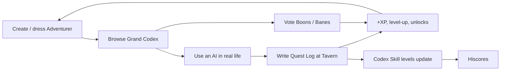
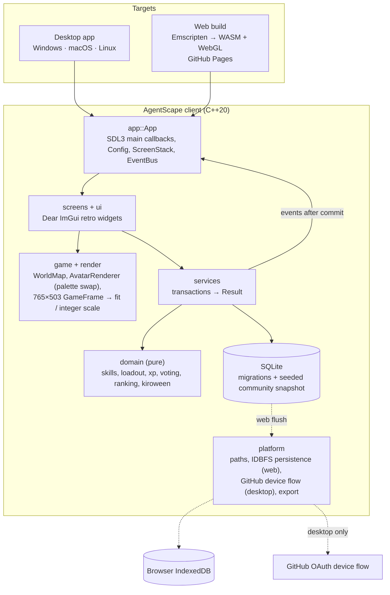
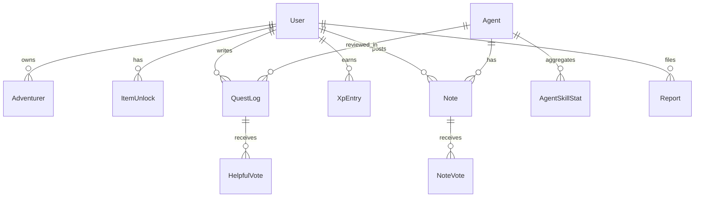

# AgentScape: Design Document

> *"Welcome to AgentScape. Rate your familiars, brave adventurer."*

## 1. Pitch

**AgentScape** is a cross-platform game for rating real-world experiences with AI models and AI tools, and for building a codex of their strengths and weaknesses. It looks and plays like the fantasy browser MMORPGs of the early 2000s. It's a native C++20 client built on SDL3 and Dear ImGui, and it runs on Windows, macOS, and Linux, and in the browser through WebAssembly.

You create a pixel-art Adventurer and dress them up, including spooky Kiroween gear. Then you walk into the town of **Promptmoor** to:

- read an Agent's **examine card** in the Grand Codex
- write **Quest Logs** about how an AI handled your task
- vote on **Boons and Banes**
- climb the **Hiscores**

The Codex ships with a seeded **community snapshot** of Agents, NPC adventurers, Quest Logs, and Notes. Your own contributions are saved locally and update it instantly. Everything works offline, and there's no server.

## 2. Hackathon fit: Resurrection

| Dead tech we revive | Modern twist |
|---|---|
| Fixed-size, plugin-era browser MMO client (765×503 frame, stone panels, chatbox, right-click "Examine") | Rebuilt as a native C++20 client on SDL3 and Dear ImGui that also compiles to WebAssembly, so it runs in the browser again. Integer scaling, plus full keyboard and gamepad navigation. |
| Paper-doll character creator with arrow buttons and colour swatches | Indexed-palette recolouring (true 8-bit palette swaps), PNG export, account-wide cosmetic unlocks |
| Fansite item databases and "tip it" guides | A community knowledge base of AI models and tools, with statistically robust scoring (Bayesian levels, Wilson-ranked notes) |
| Hiscores tables | Hiscores for AI Agents per Skill and per task type |

The target **bonus prize** is **Best Demo**: the whole core loop fits in a 3-minute video and ends with a level-up and fireworks.

## 3. Experience pillars

1. **Nostalgia you can feel in one click.** Hover text, right-click menus, yellow-on-stone text, and "Congratulations, you just advanced a level!"
2. **Useful, honest data.** Ratings are always tied to a task type. Skill levels need at least 3 ratings, and Bayesian smoothing stops one rating from dominating.
3. **Self-expression.** Adventurers, cosmetics, and seasonal gear make contributing feel rewarding.
4. **Modern under the hood.** It starts instantly, works offline, runs natively and in the browser, and is property-tested.

## 4. The world: Promptmoor

| Location | Screen | Purpose |
|---|---|---|
| Town square | World | Hub map. Your active Adventurer stands here. |
| **The Costumer** | Costumer | Character creator and wardrobe (9 equipment slots) |
| **The Grand Codex** (library) | Codex | Agent knowledge base, examine cards, Proving Grounds compare |
| **The Tavern** | Tavern | Quest board of Quest Logs (reviews) |
| **Hiscores Obelisk** | Hiscores | Agent and Adventurer leaderboards |
| **Hall of Hallucinations** (graveyard, Kiroween only) | Graveyard | Top-voted Banes as tombstones with epitaphs |
| **The Wilds** (the road south) | Wilds | Coding sessions: passive XP while you code, with the familiar fighting bug monsters beside you |

## 5. Core loop



## 6. Features

### MVP (required for submission)

- **Game shell:** login ("Play as Guest" everywhere, plus GitHub device-flow sign-in on desktop), a frame that scales to fit the window (or whole-number "Pixel-perfect scaling"), world map, context menus, chatbox activity feed, settings (plain font, reduced motion, sound, pixel-perfect scaling), and local SQLite storage that persists in the browser too.
  - Spec: [`game-shell`](../.kiro/specs/game-shell/requirements.md)
- **Character creator and Costumer:**
  - Up to 5 Adventurers per account, with 6 style axes and 5 colour palettes.
  - 4-way rotation, idle animation, 9-slot paper-doll, and two-handed and mask-hiding rules.
  - Level unlocks, the Kiroween claimables, and PNG export.
  - Spec: [`character-creator`](../.kiro/specs/character-creator/requirements.md)
- **Grand Codex:**
  - Agent examine cards with Overall level and 10 Skill levels (1–99), scoped by quest type.
  - Boons and Banes with voting, Agent proposals, local Codex Keeper moderation, the Proving Grounds compare view, and the Hall of Hallucinations.
  - Spec: [`agent-codex`](../.kiro/specs/agent-codex/requirements.md)
- **Quest Logs, XP, and Hiscores:**
  - 3-step quest scroll with overall and per-Skill gem ratings, quick tags, helpful votes, and the XP ledger.
  - Level-ups with fireworks, Agent and Adventurer Hiscores.
  - Spec: [`quest-logs`](../.kiro/specs/quest-logs/requirements.md)

- **Coding sessions and The Wilds:**
  - Start a session with a familiar or solo; 1 XP a minute, paid while playing and for time away; at most 4 hours a session and 8 hours a day.
  - The Adventurer fights original bug monsters with the familiar, or chops, mines and fishes when solo; a summary on Stop offers *Write a Quest Log*.
  - Spec: [`coding-sessions`](../.kiro/specs/coding-sessions/requirements.md)

### Stretch (only if time allows)

- Original chiptune music loop (off by default).
- Emotes (wave, cheer, *spooky dance* during Kiroween) on the world map.
- Export an Agent's examine card as a PNG for sharing.
- **Codex bundles:** export and import Quest Logs and Notes as a JSON file, so players can share contributions without a server.
- Screen-reader support through AccessKit.
- A touch-friendly layout for phones and tablets.
- "Quest chains": guided multi-step comparisons ("Try 3 Agents on the same bug").
- Additional seasonal events beyond Kiroween.

### Non-goals

- A hosted backend or shared online database. A later sync server is an open question.
- Real-time multiplayer, player-to-player chat, trading, or payments.
- Automated AI benchmarks or calling AI APIs. AgentScape records human experience.

## 7. Systems

### 7.1 Agent Skills and levels

The 10 Skills are Coding, Reasoning, Writing, Research, Creativity, Tool Use, Context, Reliability, Speed, and Value. **Overall** comes from each Quest Log's overall rating and is shown like a combat level.

```
bayes = (5 × 3 + Σ ratings) / (5 + n)          # prior mean 3, weight 5
level = clamp(1 + round((bayes − 1) / 4 × 98), 1, 99)
unranked if n < 3
Total level = Σ Skill levels (unranked = 1)    # range 10–990
```

Because of the prior, level 99 is very hard to reach (100 straight 5★ ratings give about 97). That keeps high levels prestigious.

Aggregates are stored per (Agent, Skill, Quest Type) as `(sum, count)`, so any scope is a cheap merge.

### 7.2 Boons and Banes

These are short notes (≤ 280 chars) with agree/disagree voting, ranked by **Wilson score lower bound**, so a note with 2 votes doesn't outrank a note with 200.

### 7.3 Questing XP

| Action | XP |
|---|---|
| Write a Quest Log | 250 |
| Post a Boon/Bane | 50 |
| Receive a "helpful" vote | 25 (max 250 per day) |
| Agent proposal approved | 500 |

`XP_TABLE[L] = floor(40 × (L − 1)^1.75)`. Sample values:

- Level 2 = 40
- Level 5 = 452
- Level 10 = 1,870
- Level 13 = 3,094
- Level 14 = 3,560
- Level 99 = 122,097

Guest accounts start at 3,460 XP (level 13), so a judge's first Quest Log triggers a level-up on camera.

### 7.4 Cosmetics

| Unlock | Items |
|---|---|
| Default | Wooden Stick, Plain Tunic, Plain Trousers, Leather Boots |
| Level 3–12 | Leather Gloves (3), Apprentice Hood (5), Quill Sword (8), Traveller's Cape (10), Scholar Robe/Skirt (12) |
| Level 15–40 | Token Amulet (15), Codex Tome (18), Wizard Hat (20), Prompt Staff (25, 2h), Codex Keeper's Cape (40) |
| **Kiroween (claim during event, keep forever)** | Witch's Hat, Jack-o'-Lantern Mask, Skull Mask, Ghostly Sheet, Vampire Cape, Reaper's Scythe (2h, level 13+), Candy Pail, Cobweb Boots |

## 8. Kiroween layer

Kiroween mode is active from 1 October to 15 November (UTC), or when forced with `--kiroween=on`, `KIROWEEN_MODE=on`, the web URL `?kiroween=on`, or the `AS_KIROWEEN_DEFAULT=on` build option. It adds:

- Purple and pumpkin UI accents, drifting fog, jack-o'-lanterns, and bats on the login screen.
- The **Hall of Hallucinations**: up to 13 tombstones for the community's top-voted Banes, for example: *"Here lies Reliability. It cited a paper that never existed."*
- Claimable Halloween cosmetics in the Costumer.

## 9. Art direction (summary)

The full rules are in [`.kiro/steering/art-direction.md`](../.kiro/steering/art-direction.md).

- Stone-and-parchment UI drawn with custom Dear ImGui widgets, a strict palette, pixel fonts (OFL), and the whole 765×503 frame scaled to fit the window with even, crisp pixels (nearest upscale to the next integer, then a linear downscale), or integer-only with "Pixel-perfect scaling".
- 32×48 paper-doll sprites with 4 facings, authored as 8-bit indexed PNGs and recoloured by palette swap.
- **All assets are original or permissively licensed, and logged in [ASSETS.md](./ASSETS.md).** We don't use any names, fonts, sprites, or logos from existing commercial games or AI vendors.

## 10. Architecture

One C++20 codebase builds two targets: a native desktop app and a WebAssembly build. Both use SDL3's main callbacks, so the same frame loop runs on every platform.



Stack details are in [`.kiro/steering/tech.md`](../.kiro/steering/tech.md). Folder layout is in [`.kiro/steering/structure.md`](../.kiro/steering/structure.md).

### Data model (overview)



Each spec's `design.md` has the exact tables (SQL migrations in `data/migrations/`). `User` covers local players, Guests, and seeded NPC adventurers. `ActivityEvent` feeds the chatbox.

## 11. Accessibility

- Every map or scene interaction has an equivalent list control: the hotspot list, the bookshelf table, and the graveyard list.
- Full keyboard and gamepad navigation includes the context menu (`Menu` key / Shift+F10, or the gamepad), with a visible yellow nav cursor.
- A "Plain font" toggle, reduced-motion support (static fog, idle, and fireworks), and a 12 px pixel font (1.5× its design size) so body text is readable on the 765×503 frame. On the web, reduced motion defaults to the browser setting.
- **Contrast, measured** (WCAG ratio on the stone panel `#5d5447`): yellow 6.9, cyan 5.9, green 5.4 (AA); parchment 3.8 and orange 3.5 (large text only); red 1.9, blue 1.2 and purple 1.1 (fail). Red, blue and purple are therefore not used for text on stone: errors use orange, Banes use a red chip with white text, and highlights always pair colour with a symbol or number (`*`, `4/5`, `[Agree]`).
- Level-ups and errors always appear as Chatbox text, not only as effects.
- **Known limitation:** Dear ImGui has no accessibility tree, so screen readers aren't supported in the MVP. AccessKit integration is a stretch goal.

## 12. Trust, safety, and fairness

- The shipped familiars are fictional (sample data), so no real product is rated by us. Agent text is neutral, there are no logos, and an Agent's website opens only after a "Leave AgentScape to visit <host>?" confirmation. Proposed Agents need an `https:` website.
- Rate limits: 5 Quest Logs per hour, 10 Notes per hour, 3 proposals per day.
- One Quest Log per (user, Agent, version). No self-votes. Helpful-vote XP is capped daily.
- Report → Codex Keeper queue → hide (content) or exclude (ratings).
- All user text is rendered as plain text with `ImGui::TextUnformatted`, never as a format string. All SQL uses bound parameters.
- Privacy: the GitHub access token is used once to read your profile, then discarded. Nothing leaves your machine otherwise.

## 13. Quality strategy

Property-based tests (RapidCheck) cover every pure domain rule; each spec's `design.md` lists numbered Correctness Properties. Catch2 unit and integration tests cover services against in-memory SQLite. A headless smoke test drives the exact demo path and saves a snapshot of each screen. CI builds Windows, macOS, Linux, and the web target, and runs the suite under AddressSanitizer and UBSan. Kiro hooks run formatting, the property suite, the build and tests, and art-direction reviews automatically. See [SUBMISSION.md](./SUBMISSION.md) for how Kiro was used.

## 14. Milestones

| # | Milestone | Exit criteria | Status at submission |
|---|---|---|---|
| M1 | Shell | Guest login → world map → context menu → chatbox. Desktop and web builds green in CI. Web build deployed to GitHub Pages, and data survives a reload. | Done; CI green on all targets. Pages deployment workflow added; the reload check in browsers is manual. |
| M2 | Costumer | Create, dress, and save an Adventurer. Kiroween gear claimable. PNG export works on desktop and web. | Done (desktop export tested headlessly; web download is manual). |
| M3 | Codex | Seeded Agents and NPC adventurers, examine cards, notes and votes, compare view. | Done, plus proposals, Keeper tools and the Hall of Hallucinations. |
| M4 | Quests | Quest Logs update levels. XP, level-ups, unlocks, Hiscores. | Done, plus sample Quest Logs from the townsfolk. |
| M5 | Polish and demo | Graveyard, fireworks, art pass, a11y pass, smoke test green, release binaries published, video recorded, submission filed. | Graveyard, fireworks, smoke tests and release workflow done; video, release tag and Devpost form are the remaining manual steps. |
| M6 | Coding sessions | Start and stop a session, XP while the game is closed, session and daily caps, The Wilds scene. | Done (coding-sessions spec). |

## 15. Risks and mitigations

| Risk | Mitigation |
|---|---|
| Pixel art takes longer than code | Start with a minimal sprite set (1 body type, 3 hair styles, Kiroween items first), and expand later |
| IP and trademark concerns with the retro style | Use original names and art, an asset ledger, and a hook-enforced provenance check |
| C++ toolchain friction across three OSes plus Emscripten | CMake presets, pinned `FetchContent` dependencies, and a CI matrix from day one |
| Judges can't or won't build C++ | A hosted web build on GitHub Pages plus prebuilt release binaries. The README has a one-click "Play in browser" link. |
| Browser storage is lost or blocked (private mode, a tab closed mid-write) | Flush to IndexedDB after every committed transaction and on `pagehide`. If IndexedDB is unavailable, warn and run in memory. |
| No screen-reader support in Dear ImGui | Keyboard and gamepad navigation, plain font, and text equivalents for every effect. AccessKit as a stretch goal. |
| "Community" data feels thin without a server | A rich seeded snapshot of NPC adventurers, Quest Logs, and Notes. Codex bundles (stretch) let players share contributions. |
| Unsigned binaries trigger OS warnings | Document the macOS and Windows "run anyway" steps in the README and recommend the web build first |

## 16. Open questions

Decided during the build:

- **Seed Agents:** fictional familiars and vendors, not real products, so the sample ratings never misrepresent a real tool.
- **Font size:** the pixel font is drawn at 12 px; "Plain font" remains for anyone who wants a vector face.

Still open:

- Do we want a second seasonal event to show the system is generic?
- Should Quest Logs support an optional "prompt used" field (privacy implications)?
- After the hackathon, do we add an optional sync server, or Codex bundles (export/import), so contributions can be shared?
- Sound effects: the setting exists, the sounds don't yet.
